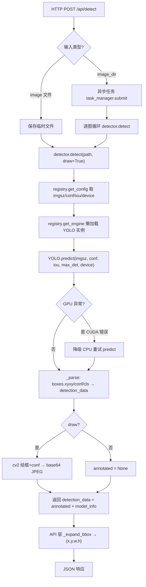
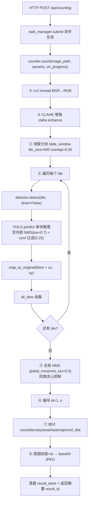

# 作物检测与计数功能实现分析报告

> 分析对象：`backend/` 后端实现代码
> 分析日期：2026-08-10
> 核心结论：**检测与计数功能均真实接入了 ultralytics 库**；计数管线与你描述的"分块→检测→映射→全局 NMS→计数"高度一致，但存在 6 处值得注意的差异（详见第二章 §2.4）。

---

## 一、作物检测功能（`/api/detect`）

### 1.1 实现概览

作物检测由 [detect_api.py](file:///d:\Data\New_Codes\Composite_Projects\UAV-Visual-Intelligence-System-in-Agriculture\backend\api\detect_api.py)（HTTP 入口）与 [detector.py](file:///d:\Data\New_Codes\Composite_Projects\UAV-Visual-Intelligence-System-in-Agriculture\backend\core\detector.py)（`DetectionEngine`）协作完成。

`DetectionEngine` 被设计为**原子化单图 YOLO 推理引擎**（见 [detector.py:1](file:///d:\Data\New_Codes\Composite_Projects\UAV-Visual-Intelligence-System-in-Agriculture\backend\core\detector.py#L1)），职责单一：接收一张图像 → 调用 YOLO 推理 → 解析结构化结果 → 可选绘制标注图。**它本身不做 CLAHE、不做分块、不做跨块 NMS 合并**——这些是计数引擎的职责。

### 1.2 数据处理流程

**入口（[detect_api.py:61](file:///d:\Data\New_Codes\Composite_Projects\UAV-Visual-Intelligence-System-in-Agriculture\backend\api\detect_api.py#L61)）：**支持两种模式

| 模式 | 触发条件 | 执行方式 | 返回 |
|------|----------|----------|------|
| 单图同步 | `multipart` 含 `image` 文件 | 同步调用 `detector.detect` | `detection_count` + `result_image`(base64) + `detection_data` |
| 批量异步 | `image_dir`（form 或 json） | 提交 `task_manager` 异步任务，逐图检测并上报进度 | `task_id`，轮询 `/api/detect/tasks/<id>(/result)` |

**推理核心（[detector.py:22](file:///d:\Data\New_Codes\Composite_Projects\UAV-Visual-Intelligence-System-in-Agriculture\backend\core\detector.py#L22) `detect()`）：**

1. **取参数**：`registry.get_config(model_name)` 取模型默认配置，推理参数优先级为 `params` > `config` > 内置默认（imgsz=640, conf=0.25, iou=0.7, max_det=300）。
2. **取引擎**：`registry.get_engine(model_name)` 懒加载并 LRU 缓存 YOLO 实例。
3. **归一化 device**：`_normalize_device` 把 `'auto'`/`''`/`None` → `None`，`'cuda:0'` → `0`（见 [detector.py:74](file:///d:\Data\New_Codes\Composite_Projects\UAV-Visual-Intelligence-System-in-Agriculture\backend\core\detector.py#L73-L94)，因 ultralytics 8.4.60 的 `select_device` 不接受 `'auto'`/`'cuda:N'` 字符串）。
4. **调用 ultralytics**：`engine.predict(image, imgsz, conf, iou, max_det, device, verbose=False)`。
5. **GPU 降级兜底**：若 CUDA 不可用，自动降级到 CPU 重试（[detector.py:46](file:///d:\Data\New_Codes\Composite_Projects\UAV-Visual-Intelligence-System-in-Agriculture\backend\core\detector.py#L44-L58)）。
6. **解析结果**：`_parse` 把 `results[0].boxes` 的 `xyxy/conf/cls` 转为 `[{bbox, confidence, class, class_name}]`（[detector.py:102](file:///d:\Data\New_Codes\Composite_Projects\UAV-Visual-Intelligence-System-in-Agriculture\backend\core\detector.py#L102-L117)）。
7. **可选绘制**：`draw=True` 时用 cv2 在图上画红框 + 置信度，编码为 base64 JPEG（[detector.py:119](file:///d:\Data\New_Codes\Composite_Projects\UAV-Visual-Intelligence-System-in-Agriculture\backend\core\detector.py#L119-L144)）。
8. **API 层展开 bbox**：`_expand_bbox` 把 `[x1,y1,x2,y2]` 展开为 `{x, y, width, height}`（[detect_api.py:47](file:///d:\Data\New_Codes\Composite_Projects\UAV-Visual-Intelligence-System-in-Agriculture\backend\api\detect_api.py#L47-L58)）。

### 1.3 算法调用逻辑（mermaid）



### 1.4 是否真实使用 ultralytics？

**是，真实使用。** 证据链：

| 证据 | 位置 | 说明 |
|------|------|------|
| 依赖声明 | [requirements.txt:30](file:///d:\Data\New_Codes\Composite_Projects\UAV-Visual-Intelligence-System-in-Agriculture\requirements.txt#L30) | `ultralytics==8.4.60`，与训练环境对齐 |
| 真实导入 | [registry.py:189](file:///d:\Data\New_Codes\Composite_Projects\UAV-Visual-Intelligence-System-in-Agriculture\backend\core\registry.py#L187-L190) | `from ultralytics import YOLO; return YOLO(weight)` |
| 真实调用 | [detector.py:35](file:///d:\Data\New_Codes\Composite_Projects\UAV-Visual-Intelligence-System-in-Agriculture\backend\core\detector.py#L34-L43) | `engine.predict(image, imgsz, conf, iou, max_det, device)` |
| 权重就绪 | `models/*.pt` | 5 个真实权重文件（v5su/v8s/v11s/v12s/v12n）已存在 |
| 引擎配置 | [models.yaml](file:///d:\Data\New_Codes\Composite_Projects\UAV-Visual-Intelligence-System-in-Agriculture\config\models.yaml) | 5 个模型 `engine: ultralytics`，weight 指向真实 `.pt` |

**两点说明：**

- **懒加载**：ultralytics 在 `_load_engine` 中**首次取引擎时才导入**（[registry.py:188](file:///d:\Data\New_Codes\Composite_Projects\UAV-Visual-Intelligence-System-in-Agriculture\backend\core\registry.py#L187-L190)），因此即使 ultralytics/torch 未安装，模型管理（列表/注册/热切换）仍可正常工作，仅检测/计数 API 降级返回 `success:False`（见 [engine.py:42](file:///d:\Data\New_Codes\Composite_Projects\UAV-Visual-Intelligence-System-in-Agriculture\backend\core\engine.py#L42-L51)）。
- **单测用 Mock**：[test_detector.py](file:///d:\Data\New_Codes\Composite_Projects\UAV-Visual-Intelligence-System-in-Agriculture\backend\tests\test_detector.py) 用 `MagicMock` 模拟 YOLO 结果以规避重依赖，这是**测试策略**，不代表生产代码用假实现。生产代码路径是真实 ultralytics 调用。

---

## 二、作物计数功能（`/api/counting`）

### 2.1 实现概览

计数由 [counting_api.py](file:///d:\Data\New_Codes\Composite_Projects\UAV-Visual-Intelligence-System-in-Agriculture\backend\api\counting_api.py)（HTTP 入口，纯异步）与 [counter.py](file:///d:\Data\New_Codes\Composite_Projects\UAV-Visual-Intelligence-System-in-Agriculture\backend\core\counter.py)（`CountingEngine`）协作完成。

`CountingEngine` 是**编排者**，它组合复用 `DetectionEngine`（注入 detector，见 [counter.py:17](file:///d:\Data\New_Codes\Composite_Projects\UAV-Visual-Intelligence-System-in-Agriculture\backend\core\counter.py#L17-L19)），在其外层编排 CLAHE → 分块 → 逐块检测 → 坐标映射 → 全局 NMS → 统计 → 可视化的完整管线。

### 2.2 数据处理流程（[counter.py:21](file:///d:\Data\New_Codes\Composite_Projects\UAV-Visual-Intelligence-System-in-Agriculture\backend\core\counter.py#L21) `count()`）

| 步骤 | 代码位置 | 操作 | 说明 |
|------|----------|------|------|
| ① 加载原图 | [counter.py:30](file:///d:\Data\New_Codes\Composite_Projects\UAV-Visual-Intelligence-System-in-Agriculture\backend\core\counter.py#L30-L35) | `cv2.imread` → BGR→RGB | 统一为 RGB 数组 |
| ② CLAHE | [counter.py:40](file:///d:\Data\New_Codes\Composite_Projects\UAV-Visual-Intelligence-System-in-Agriculture\backend\core\counter.py#L38-L40) | `clahe.enhance(original)` | 彩色图 RGB→LAB→L 通道均衡→RGB |
| ③ 分块 | [counter.py:43](file:///d:\Data\New_Codes\Composite_Projects\UAV-Visual-Intelligence-System-in-Agriculture\backend\core\counter.py#L43) | `tiling.slide_window(enhanced, 640, 0.05)` | 步长=640×0.95=608，边缘回退保证 640×640 |
| ④ 逐块检测+映射 | [counter.py:48](file:///d:\Data\New_Codes\Composite_Projects\UAV-Visual-Intelligence-System-in-Agriculture\backend\core\counter.py#L48-L54) | `detector.detect(tile, draw=False)` → `map_to_original(bbox, ox, oy)` | 复用检测引擎；每块不画图 |
| ⑤ 全局 NMS | [counter.py:57](file:///d:\Data\New_Codes\Composite_Projects\UAV-Visual-Intelligence-System-in-Agriculture\backend\core\counter.py#L57) | `nms.global_nms(all_dets, 0.5)` | 贪心 + 同类才抑制，按 conf 降序 |
| ⑥ 编号 | [counter.py:58](file:///d:\Data\New_Codes\Composite_Projects\UAV-Visual-Intelligence-System-in-Agriculture\backend\core\counter.py#L58-L59) | `det["id"] = idx` | 1..n |
| ⑦ 统计 | [counter.py:62](file:///d:\Data\New_Codes\Composite_Projects\UAV-Visual-Intelligence-System-in-Agriculture\backend\core\counter.py#L62-L64) | count / density / area / heatmap / conf_dist | 密度基于 ground_resolution(cm/px) |
| ⑧ 可视化 | [counter.py:67](file:///d:\Data\New_Codes\Composite_Projects\UAV-Visual-Intelligence-System-in-Agriculture\backend\core\counter.py#L67) | 原图绘框+编号 → base64 JPEG | 在原图（非增强图）上绘制 |

**入口侧（[counting_api.py:69](file:///d:\Data\New_Codes\Composite_Projects\UAV-Visual-Intelligence-System-in-Agriculture\backend\api\counting_api.py#L69)）：**纯异步——`task_manager.submit("counting", _run)` 提交任务，`on_progress` 回调把 `enhancing`/`detecting` 阶段映射为 0~1 进度（[counting_api.py:123](file:///d:\Data\New_Codes\Composite_Projects\UAV-Visual-Intelligence-System-in-Agriculture\backend\api\counting_api.py#L123-L131)）。结果经 [result_store.py](file:///d:\Data\New_Codes\Composite_Projects\UAV-Visual-Intelligence-System-in-Agriculture\backend\core\result_store.py) 落盘到 `results/{result_id}/`（标注图 + meta.json + counting_data.json）。

### 2.3 算法调用逻辑（mermaid）

**完整管线流程图：**



**调用时序图（突出 ultralytics 真实调用点）：**

```mermaid
sequenceDiagram
    participant API as counting_api
    participant TM as TaskManager
    participant CE as CountingEngine
    participant DE as DetectionEngine
    participant Reg as ModelRegistry
    participant YOLO as ultralytics YOLO

    API->>TM: submit("counting", _run)
    TM-->>API: task_id
    TM->>CE: count(image_path, params, on_progress)
    CE->>CE: ① imread ② CLAHE ③ slide_window
    loop 每个 tile (i=1..N)
        CE->>DE: detect(tile, draw=False)
        DE->>Reg: get_config / get_engine(首次懒加载)
        Reg->>YOLO: from ultralytics import YOLO; YOLO(weight)
        DE->>YOLO: predict(imgsz, conf, iou, max_det, device)
        Note over YOLO: 内部已完成 conf 过滤 + 单块 NMS
        YOLO-->>DE: results[0]
        DE-->>CE: detection_data（子图坐标）
        CE->>CE: map_to_original(bbox, ox, oy)
    end
    CE->>CE: ⑤ global_nms(all_dets, 0.5)
    CE->>CE: ⑥ 编号 ⑦ 统计 ⑧ 绘图
    CE-->>TM: result
    TM->>API: save_counting_result + 返回 result_id
```

### 2.4 与你描述管线的对照与差异

你描述的计数管线为：
> 分块为若干张 640×640 子图 → 调用作物检测服务得到每块检测结果 → 按偏移映射回原图坐标 → 对整个原图做 conf 抑制 + NMS 去重 → 得到最终计数。

**结论：整体管线高度一致，核心四步（分块→检测→映射→全局 NMS→计数）全部命中。** 但存在以下 **6 处差异**，按影响程度排列：

#### 差异 1：分块前多了一步 CLAHE 预处理（你未提及）

实际在分块前对原图做 **CLAHE（对比度受限自适应直方图均衡化）** 增强（[counter.py:40](file:///d:\Data\New_Codes\Composite_Projects\UAV-Visual-Intelligence-System-in-Agriculture\backend\core\counter.py#L38-L40) → [clahe.py](file:///d:\Data\New_Codes\Composite_Projects\UAV-Visual-Intelligence-System-in-Agriculture\backend\core\clahe.py)）。彩色图转 LAB 后对 L 通道均衡，目的是提升无人机航拍图的局部对比度，改善弱光/低对比区域的检出率。**分块与检测都作用在增强后的图上**。

#### 差异 2：分块带 5% 重叠（非严格无重叠）

`slide_window` 默认 `overlap_ratio=0.05`，步长 = 640×0.95 = **608px**（[tiling.py:6](file:///d:\Data\New_Codes\Composite_Projects\UAV-Visual-Intelligence-System-in-Agriculture\backend\core\tiling.py#L4-L19)）。相邻 tile 有 32px 重叠区，边缘不足一步时回退到 `length - tile_size` 保证最后一块也是完整 640×640。**重叠是全局 NMS 存在的根本原因**——重叠区同一目标会被相邻 tile 各检出一次，必须靠全局 NMS 合并。

#### 差异 3："conf 抑制"并非独立全局步骤

你描述的"对整个原图进行 conf 抑制"暗示有一个映射后的全局 conf 阈值过滤。**实际没有这一独立步骤**——conf 过滤发生在每块检测**内部**，由 ultralytics `YOLO.predict(conf=0.25)` 完成（[detector.py:38](file:///d:\Data\New_Codes\Composite_Projects\UAV-Visual-Intelligence-System-in-Agriculture\backend\core\detector.py#L34-L43)）。映射后不再做二次 conf 过滤，直接进入 NMS。换言之：**conf 抑制是 per-tile 的，不是全局的**。

#### 差异 4：存在两层 NMS（你只描述了全局层）

| 层级 | 位置 | 实现 | 默认阈值 | 作用域 |
|------|------|------|----------|--------|
| 第一层 | ultralytics `predict` 内部 | 框架自带 | `iou=0.7` | 单个 tile 内部去重 |
| 第二层 | [nms.global_nms](file:///d:\Data\New_Codes\Composite_Projects\UAV-Visual-Intelligence-System-in-Agriculture\backend\core\nms.py#L9-L16) | **自定义 Python 贪心实现** | `nms_iou=0.5` | 映射后的全图去重 |

你描述的"对整个原图进行 NMS 去重"对应第二层；第一层是 ultralytics 隐含的、单块内去重。

#### 差异 5：全局 NMS 是 class-aware（同类才抑制）

`global_nms` 的抑制条件为 `det["class"] == k["class"] and _iou(...) > iou_threshold`（[nms.py:15](file:///d:\Data\New_Codes\Composite_Projects\UAV-Visual-Intelligence-System-in-Agriculture\backend\core\nms.py#L14-L16)），即**只对同类框抑制，跨类不抑制**。当前模型只有单类（Sugarcane Seedling），此差异暂无实际影响，但多类场景下会保留重叠的不同类别框。

#### 差异 6：NMS 后还有编号 + 多维统计 + 可视化

NMS 去重后并非直接结束，还附加：
- **编号**：每个保留框分配 `id`（1..n），用于可视化标注（[counter.py:58](file:///d:\Data\New_Codes\Composite_Projects\UAV-Visual-Intelligence-System-in-Agriculture\backend\core\counter.py#L58-L59)）；
- **统计**：密度（基于 `ground_resolution` cm/px 换算面积）、8×8 热力图、置信度分档（high≥0.7 / mid≥0.4 / low）（[counter.py:62](file:///d:\Data\New_Codes\Composite_Projects\UAV-Visual-Intelligence-System-in-Agriculture\backend\core\counter.py#L62-L64)、[counter.py:82](file:///d:\Data\New_Codes\Composite_Projects\UAV-Visual-Intelligence-System-in-Agriculture\backend\core\counter.py#L82-L103)）；
- **可视化**：在**原图**（非增强图）上绘框+编号，编码为 base64 JPEG（[counter.py:67](file:///d:\Data\New_Codes\Composite_Projects\UAV-Visual-Intelligence-System-in-Agriculture\backend\core\counter.py#L67)）。

### 2.5 是否真实使用 ultralytics？

**是，真实使用。** 计数引擎通过组合复用 `DetectionEngine`，每个 tile 的检测都走 `detector.detect` → `YOLO.predict`（见 2.3 时序图）。因此计数**传递性地真实使用 ultralytics**——ultralytics 是计数管线的推理核心，CLAHE/分块/映射/NMS 只是围绕它的前后处理。单测中 [test_counter.py](file:///d:\Data\New_Codes\Composite_Projects\UAV-Visual-Intelligence-System-in-Agriculture\backend\tests\test_counter.py) 用 MagicMock 替身 detector 并 patch `clahe.enhance` 为 passthrough，使管线对纯 numpy 数据确定性可测，这同样是测试策略而非生产实现。

---

## 三、总结

| 维度 | 作物检测 `/api/detect` | 作物计数 `/api/counting` |
|------|------------------------|--------------------------|
| 引擎类 | `DetectionEngine`（原子单图） | `CountingEngine`（编排者，复用 DetectionEngine） |
| 同步/异步 | 单图同步 / 批量异步 | 纯异步 |
| 预处理 | 无 | CLAHE 增强 |
| 分块 | 无（整图直送，imgsz 由 ultralytics 内部 letterbox） | 滑窗 640×640，5% 重叠 |
| 坐标映射 | 无（不需要） | `map_to_original(bbox + offset)` |
| NMS | 仅 ultralytics 内部单图 NMS（iou=0.7） | 两层：ultralytics 内部(0.7) + 自定义全局(0.5, 同类贪心) |
| conf 过滤 | ultralytics 内部（conf=0.25） | 同左（per-tile，无全局二次过滤） |
| 产物 | detection_data + 标注图 | count + density + heatmap + conf_dist + 标注图 + 落盘 |
| 真实用 ultralytics | ✅ 是 | ✅ 是（传递性） |

**对你第二问的直接回答：** 你描述的管线骨架（分块→逐块检测→偏移映射→全局 NMS→计数）**完全成立**，与代码实现一致。差异集中在 6 个细节：① 多了 CLAHE 预处理；② 分块带 5% 重叠；③ conf 抑制是 per-tile 而非全局独立步骤；④ 有两层 NMS；⑤ 全局 NMS 同类才抑制；⑥ NMS 后还有编号/统计/可视化。这些差异中，②与④是"重叠分块必然需要全局 NMS"的因果闭环，①③⑤是设计选择，⑥是功能扩展。
