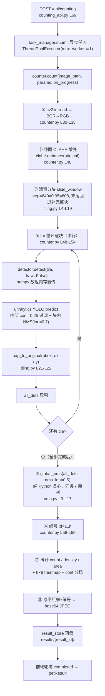
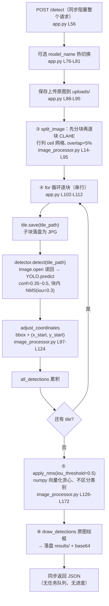

# 作物计数实现对比与改进分析报告

> 对比对象：当前项目 `UAV-Visual-Intelligence-System-in-Agriculture` vs 参照项目 `Smart Sugarcane Seedling Service System`
> 分析日期：2026-08-10
> 核心结论：**用户疑虑的"未逐块检测、未等全部子块完成就合并"在代码层面不成立**（证据见第三章）；但当前计数管线存在 **3 个影响计数准确性的 P0 级真实缺陷**（重叠区重复计数、边界截断漏计、重叠率偏小），以及若干性能与健壮性短板。改进方案见第六章。

---

## 一、对比对象与方法

### 1.1 项目与文件清单

**当前项目**（根目录：`d:\Data\New_Codes\Composite_Projects\UAV-Visual-Intelligence-System-in-Agriculture`）

| 角色 | 文件 |
|------|------|
| HTTP 入口（异步任务） | [counting_api.py](file:///d:\Data\New_Codes\Composite_Projects\UAV-Visual-Intelligence-System-in-Agriculture\backend\api\counting_api.py)（`backend/api/counting_api.py`） |
| 计数编排 | [counter.py](file:///d:\Data\New_Codes\Composite_Projects\UAV-Visual-Intelligence-System-in-Agriculture\backend\core\counter.py)（`backend/core/counter.py`，`CountingEngine`） |
| 分块与坐标映射 | [tiling.py](file:///d:\Data\New_Codes\Composite_Projects\UAV-Visual-Intelligence-System-in-Agriculture\backend\core\tiling.py)（`backend/core/tiling.py`） |
| CLAHE 增强 | [clahe.py](file:///d:\Data\New_Codes\Composite_Projects\UAV-Visual-Intelligence-System-in-Agriculture\backend\core\clahe.py)（`backend/core/clahe.py`） |
| 全局 NMS | [nms.py](file:///d:\Data\New_Codes\Composite_Projects\UAV-Visual-Intelligence-System-in-Agriculture\backend\core\nms.py)（`backend/core/nms.py`） |
| 单图检测引擎 | [detector.py](file:///d:\Data\New_Codes\Composite_Projects\UAV-Visual-Intelligence-System-in-Agriculture\backend\core\detector.py)（`backend/core/detector.py`，`DetectionEngine`） |
| 任务管理 / 引擎装配 | `backend/core/task_manager.py`、`backend/core/engine.py` |
| 前端轮询 | `frontend/src/stores/counting.ts`、`frontend/src/views/algo/Counting.vue` |
| 模型配置 | `config/models.yaml` |

**参照项目**（根目录：`D:\Data\New_Codes\Composite_Projects\Smart Sugarcane Seedling Service System`，位于本工作区之外，链接不可跳转时请按相对路径查阅）

| 角色 | 文件（相对参照项目根） |
|------|------|
| HTTP 入口（同步阻塞） | `backend/app.py`（`/detect` 端点 L56-L160） |
| 分块/CLAHE/坐标调整/NMS/绘制 | `backend/modules/image_processor.py`（`ImageProcessor`） |
| 检测器门面 | `backend/modules/detector.py`（`YOLODetector`） |
| Ultralytics 引擎 | `backend/modules/engines/ultralytics_detector.py`（`UltralyticsDetector`） |
| 模型配置 | `backend/config/models.yaml` |

### 1.2 比对维度

按管线执行顺序逐环节比对：**预处理（CLAHE）→ 分块 → 子块检测 → 坐标映射 → 全局合并（NMS）→ 统计/可视化 → 执行模型（同步/异步、容错、参数）**。

---

## 二、管线架构对比

### 2.1 当前项目管线（`CountingEngine.count`，[counter.py:21-80](file:///d:\Data\New_Codes\Composite_Projects\UAV-Visual-Intelligence-System-in-Agriculture\backend\core\counter.py#L21-L80)）



### 2.2 参照项目管线（`/detect` 端点，`backend/app.py` L56-L160）



### 2.3 逐环节差异对照表

| 环节 | 当前项目 | 参照项目 | 差异评价 |
|------|---------|---------|---------|
| **CLAHE 时机** | 整图增强后分块（[counter.py:40](file:///d:\Data\New_Codes\Composite_Projects\UAV-Visual-Intelligence-System-in-Agriculture\backend\core\counter.py#L38-L40) → [clahe.py:5-11](file:///d:\Data\New_Codes\Composite_Projects\UAV-Visual-Intelligence-System-in-Agriculture\backend\core\clahe.py#L5-L11)） | 分块后对每块单独增强（`image_processor.py` L60-L81） | 各有取舍：整图增强无块间亮度跳变但内存多一份整图；逐块增强省内存但块间对比度不一致可能影响边界检测 |
| **分块算法** | 滑窗：`starts=range(0, L-641, 608)`，末块回退至 `L-640` 保证完整 640²（[tiling.py:4-19](file:///d:\Data\New_Codes\Composite_Projects\UAV-Visual-Intelligence-System-in-Agriculture\backend\core\tiling.py#L4-L19)） | 行列 ceil 定网格数，末行/列钳制并回拉成完整块（`image_processor.py` L33-L55） | 覆盖性等价（均全覆盖原图、末块完整）；当前实现更简洁。参照项目 L52-L55 的末块调整条件冗余易误读（见 §5.4） |
| **重叠率** | 默认 5%（32px），前端可调（`Counting.vue` L87） | 默认 5%（32px），form 参数可调 | 两者相同；**但 5% 对边界截断目标偏小**（见 §4.1-④） |
| **子块检测输入** | numpy 数组内存直传 `predict(tile)`（[counter.py:51](file:///d:\Data\New_Codes\Composite_Projects\UAV-Visual-Intelligence-System-in-Agriculture\backend\core\counter.py#L48-L54)） | 子块 `save()` 落盘 JPG → `Image.open` 读回（`app.py` L104-L108） | 当前实现更优：参照项目多出 N 次磁盘 I/O + JPEG 有损压缩，既慢又可能损伤细节 |
| **坐标映射** | `map_to_original(bbox, ox, oy)` 纯偏移加和（[tiling.py:21-22](file:///d:\Data\New_Codes\Composite_Projects\UAV-Visual-Intelligence-System-in-Agriculture\backend\core\tiling.py#L21-L22)） | `adjust_coordinates` 同为偏移加和，但 copy 了检测结果字典 | 等价，无实质差异 |
| **全局 NMS** | 纯 Python 贪心 O(n²)，**class-aware**（同类才抑制，[nms.py:9-17](file:///d:\Data\New_Codes\Composite_Projects\UAV-Visual-Intelligence-System-in-Agriculture\backend\core\nms.py#L9-L17)） | numpy 向量化贪心，**class-agnostic**（跨类也抑制，`image_processor.py` L126-L172） | 当前实现算法语义更正确（多类场景不误杀），但性能差；参照实现快但多类场景有缺陷。单类场景两者结果一致 |
| **conf 过滤** | 仅 per-tile（ultralytics 内部 conf=0.25），映射后无二次过滤 | 仅 per-tile（conf=0.35~0.5 随模型配置） | 两者同构；当前项目默认 conf 更低（0.25），低分框更多（见 §4.1-③） |
| **执行模型** | 异步任务 + 进度回调（`on_progress` → 0~1 进度）+ 结果落盘 + 历史查询 | 同步阻塞单个 HTTP 请求，无进度、无任务队列、无历史 | 当前实现显著更优 |
| **容错** | GPU→CPU 降级重试（[detector.py:44-58](file:///d:\Data\New_Codes\Composite_Projects\UAV-Visual-Intelligence-System-in-Agriculture\backend\core\detector.py#L44-L58)），但无块级容错 | 无任何降级 | 当前实现更好，但仍有短板（见 §4.3-⑧） |
| **默认参数** | conf=0.25 / 块内 iou=0.7 / 全局 nms_iou=0.5 / max_det=1000（`config/models.yaml`） | conf=0.35~0.5 / 块内 iou=0.3 / 全局 0.5 / max_det=300（引擎默认） | 当前项目 conf 更低、max_det 更宽，召回高但虚高风险也高 |
| **附加统计** | 密度（ground_resolution 换算）、8×8 热力图、置信度分档、编号 | 仅 detection_count | 当前实现功能更全 |

---

## 三、用户疑虑专项核查

**疑虑原文**：*"当前项目的计数逻辑似乎存在缺陷，并没有逐一对每个分块的子块进行检测，并且等待所有的子块都检测完成之后再进行最终结果的合并。"*

### 3.1 核查结论：**疑虑在代码层面不成立**

三处关键证据：

**证据 1 — 后端确实逐块检测、全部完成后才合并**（[counter.py:46-57](file:///d:\Data\New_Codes\Composite_Projects\UAV-Visual-Intelligence-System-in-Agriculture\backend\core\counter.py#L46-L57)）：

```python
all_dets = []
r = {}
for i, (tile, ox, oy) in enumerate(tiles):          # ← 遍历每一个分块
    if on_progress:
        on_progress("detecting", i + 1, len(tiles)) # ← 每块上报进度
    r = self.detector.detect(tile, model_name=model_name, params=params, draw=False)
    for det in r["detection_data"]:
        det["bbox"] = tiling.map_to_original(det["bbox"], ox, oy)
        all_dets.append(det)                        # ← 累积所有块的检测结果

merged = nms.global_nms(all_dets, nms_iou)          # ← 循环结束后才全局合并
```

这是**同步串行**循环：`for` 体内每轮阻塞等待 `detector.detect` 返回，`global_nms` 位于循环之外，必然在**所有子块检测完成后**才执行。不存在跳过子块、提前合并或部分结果先行返回的代码路径。

**证据 2 — 结果一次性生成、一次性落盘**（[counting_api.py:120-156](file:///d:\Data\New_Codes\Composite_Projects\UAV-Visual-Intelligence-System-in-Agriculture\backend\api\counting_api.py#L120-L156)）：整条管线封装在单一异步任务 `_run` 内，`counter.count` 返回完整结果后才 `save_counting_result`，任务状态才置为 `completed`。

**证据 3 — 前端仅在任务完成后取完整结果**（`frontend/src/stores/counting.ts` L40-L43）：轮询到 `status === 'completed'` 才调用 `getResult`，此前只更新进度条，不存在前端侧的提前合并。

**测试佐证**：[test_counter.py:65-135](file:///d:\Data\New_Codes\Composite_Projects\UAV-Visual-Intelligence-System-in-Agriculture\backend\tests\test_counter.py#L65-L135) 端到端用例断言了 `tile_count == 2`、每块均触发 `detecting` 进度、两块的检测结果经映射后都出现在最终 `detection_data` 中——逐块检测与合并语义已被单测覆盖。

### 3.2 为什么会产生"计数异常"的观感？

既然逐块检测与合并时序无误，用户观察到的计数结果异常更可能来自以下真实原因（详见第四章）：

1. **计数虚高**：重叠区同一目标被相邻两块各检出一次，两框因边界截断而 IoU < 0.5，`global_nms` 无法合并 → 一个苗被计成两个（§4.1-①）；
2. **计数偏低**：恰好被块边界切断的目标，两侧碎片都不足 conf=0.25 → 整株漏检（§4.1-②）；
3. **过程不透明**：异步任务下前端只见进度条百分比，大图串行推理耗时长（几十块逐一推理），容易让人怀疑"没有真的逐块跑"。建议在改进中补充每块检测数的日志/明细以自证。

---

## 四、当前项目真实问题清单

### 4.1 P0 — 计数准确性（直接影响 count 正确性）

**① 重叠区重复计数：全局 NMS 的 IoU 判据对"截断框对"失效**

同一目标若落在两块的重叠带内，A 块看到完整目标输出完整框，B 块只看到被边界截断的部分输出截断框（或框位置因上下文缺失而偏移）。两框的 IoU 常在 0.2~0.45 之间，低于 `nms_iou=0.5` 的抑制阈值（[nms.py:15](file:///d:\Data\New_Codes\Composite_Projects\UAV-Visual-Intelligence-System-in-Agriculture\backend\core\nms.py#L9-L17)），于是**同一株苗被保留两个框 → 计数虚高**。这是滑窗计数管线的经典缺陷，IoU-NMS 并非为"跨块同一目标合并"设计的判据。

**② 边界截断漏检：5% 重叠不足以"救回"被切断的目标**

重叠带仅 32px。若一株苗恰好被块边界穿过，且在相邻块中可见部分过少，两块推理都可能因上下文不足而低于 conf 阈值 → **整株漏计**。提高重叠率可让目标在其中一块中以较完整形态出现（见 §6 P0-2）。

**③ conf 过滤仅 per-tile，无全局二次过滤**

conf 过滤发生在每块的 `predict(conf=0.25)` 内部（[detector.py:35-43](file:///d:\Data\New_Codes\Composite_Projects\UAV-Visual-Intelligence-System-in-Agriculture\backend\core\detector.py#L34-L43)），映射回原图后没有第二次全局置信度过滤。且本项目默认 conf=0.25 明显低于参照项目的 0.35~0.5，意味着**更多低质量框进入全局合并阶段**，进一步放大①的虚高风险。`Counting.vue` 提交参数中也未暴露 conf 调节项，用户无法调优。

**④ 默认重叠率 5% 偏小**

SAHI 等主流切片推理方案惯例重叠率为 10%~20%。当前 `overlap_ratio=0.05`（[counting_api.py:24](file:///d:\Data\New_Codes\Composite_Projects\UAV-Visual-Intelligence-System-in-Agriculture\backend\core\counter.py#L24) 默认值与 `Counting.vue` L87 前端默认值）对边界目标的冗余覆盖不足。

### 4.2 P1 — 性能

**⑤ `global_nms` 纯 Python 贪心，O(n²) 且常数大**

[nms.py:9-17](file:///d:\Data\New_Codes\Composite_Projects\UAV-Visual-Intelligence-System-in-Agriculture\backend\core\nms.py#L9-L17) 对每个候选框用 `any(...)` 与已保留框逐一算 IoU。高分辨率航拍图（如 8000×6000 → 约 13×10=130 块）若检出数千框，此步耗时显著。参照项目的 numpy 向量化写法（`image_processor.py` L126-L172）在这一点上更优，可借鉴其向量化思路（但保留本项目的 class-aware 语义）。

**⑥ 逐块串行推理，未利用批量推理**

每块独立调用一次 `engine.predict`（[counter.py:51](file:///d:\Data\New_Codes\Composite_Projects\UAV-Visual-Intelligence-System-in-Agriculture\backend\core\counter.py#L48-L54)），GPU 批处理完全闲置。ultralytics 支持一次传入图像列表批量推理，100+ 块的大图可明显提速。

**⑦ 整图 CLAHE 的内存峰值**

对超大图先做整图增强（[counter.py:40](file:///d:\Data\New_Codes\Composite_Projects\UAV-Visual-Intelligence-System-in-Agriculture\backend\core\counter.py#L38-L40)），内存中同时驻留原图 + 增强图两份全尺寸数据，之后才是分块视图。万级像素航拍图下内存压力大。参照项目的逐块增强在此点更省内存（但引入块间亮度不一致的取舍）。

### 4.3 P2 — 工程健壮性

**⑧ 无块级容错：单块失败即整任务失败**

[counter.py:48-54](file:///d:\Data\New_Codes\Composite_Projects\UAV-Visual-Intelligence-System-in-Agriculture\backend\core\counter.py#L46-L57) 循环内无 try/except，任一 tile 抛异常（显存 OOM、图像解码异常等）会令整个计数任务 `failed`，已完成的几十块工作全部作废。detector 层虽有 GPU→CPU 降级（[detector.py:44-58](file:///d:\Data\New_Codes\Composite_Projects\UAV-Visual-Intelligence-System-in-Agriculture\backend\core\detector.py#L44-L58)），但覆盖不了所有异常类型。

**⑨ `max_det=1000` 每块截断无告警**

ultralytics 单块最多保留 1000 框（`config/models.yaml` 各模型 `max_det: 1000`）。密植场景若某块目标超过上限，低分框被静默丢弃且结果中无任何提示，造成不可察觉的漏计。

**⑩ `model_info` 依赖最后一块的返回**

[counter.py:47](file:///d:\Data\New_Codes\Composite_Projects\UAV-Visual-Intelligence-System-in-Agriculture\backend\core\counter.py#L46-L47) 处 `r = {}` 在循环外初始化，`model_info` 取自 `r.get("model_info")`（L76）。极端情况（tiles 为空）下为 None；语义上 `model_info` 也应在循环外通过 `registry.get_config` 直接获取，而非搭最后一块检测结果的"便车"。

---

## 五、参照项目缺陷（不可照搬项）

对比不是单向的。参照项目有以下明显劣于当前实现的设计，改进时**不应引入**：

1. **class-agnostic NMS**（`image_processor.py` L126-L172）：`apply_nms` 的抑制条件不含类别判断，多类场景下重叠的不同类别框会被误抑制。当前模型单类暂不受影响，但当前项目的 class-aware `global_nms` 语义更正确，应保留。
2. **子块落盘再检测**（`app.py` L104-L108）：每块 `tile.save()` 写 JPG、检测时再 `Image.open` 读回——N 次磁盘 I/O + JPEG 有损压缩（对幼苗细弱叶片是实质性信息损失）。当前的内存直传是正确做法。
3. **同步阻塞执行模型**（`app.py` L56-L160）：大图计数会长时间占用 HTTP worker，无进度反馈、无并发任务、无历史留存。当前的异步任务 + 进度回调 + result_store 落盘显著更优。
4. **末块调整逻辑冗余**（`image_processor.py` L52-L55）：`if col == n_cols - 1 and x_end - tile_size > 0` 中，`x_end` 已被 L48 钳制为 `min(x_start+tile_size, width)`，该条件在多数满块场景下做的是无效果的重赋值，代码意图（末块回拉成完整尺寸）不直观。当前项目 `tiling.calc_starts` 的末尾回退写法更清晰。
5. **无容错与降级**：检测失败即 500，无 GPU 降级、无块级兜底。

---

## 六、改进方案（按优先级）

> 说明：以下为改进建议与具体落点，本次仅写入报告，不改代码。实施时需同步增补 `backend/tests/test_counter.py`、`test_nms.py`、`test_tiling.py` 用例。

### P0 — 计数准确性（优先实施）

**P0-1 全局合并判据升级：中心点距离去重 / 加权框融合（WBF）**

- **落点**：`backend/core/nms.py` 新增 `merge_by_center(dets, dist_thresh)`：按类别分组 → 以框中心欧氏距离聚类（阈值可设为目标典型尺寸的 0.5~1 倍）→ 每簇取最高 conf 框，或按 conf 加权融合出更稳的框（WBF 思路）；`backend/core/counter.py` L57 处按参数切换 `merge_mode: "nms" | "center" | "wbf"`（默认建议 `"center"`）；`backend/api/counting_api.py` `_COUNTING_PARAM_TYPES`（L29-L39）增补 `merge_mode`、`merge_dist` 两键。
- **理由**：中心点距离对"完整框 vs 截断框"天然鲁棒——同一目标无论框形被边界截成什么样，中心点彼此很近，而 IoU 对框形敏感。此项直接针对 §4.1-①，是修复计数虚高的关键。

**P0-2 默认重叠率 0.05 → 0.15**

- **落点**：`backend/core/counter.py` L24 默认值、`frontend/src/views/algo/Counting.vue` L87 `overlap_ratio` 初始值。
- **理由**：针对 §4.1-②，更大的重叠带让边界截断目标在相邻块中以更完整形态出现，配合 P0-1 的去重不会引入虚高。成本是块数增加约 40%（串行场景耗时同增，故与 P1-2 批量推理配套实施更佳）。

**P0-3 全局 conf 二次过滤 + 前端暴露 conf 参数**

- **落点**：`backend/core/counter.py` 在坐标映射后、合并前增加 `global_conf` 过滤（默认可取 0.3）；`backend/api/counting_api.py` `_COUNTING_PARAM_TYPES` 增补 `conf`（已有）之外的 `global_conf` 键；`Counting.vue` 参数区增加 conf / global_conf 输入项。
- **理由**：针对 §4.1-③，给用户一个独立的"全局置信度闸门"，与每块内部的 conf 过滤分层。

### P1 — 性能

**P1-1 `global_nms` numpy 向量化**

- **落点**：`backend/core/nms.py`，借鉴参照项目 `image_processor.py` L139-L169 的向量化 IoU 计算，但**按类别分桶**分别执行以保持 class-aware 语义。
- **注意**：保持函数签名与返回顺序（按 conf 降序）不变，避免破坏 `test_nms.py` 与编号稳定性。

**P1-2 批量分块推理**

- **落点**：`backend/core/detector.py` 增加 `detect_batch(images, ...)`（一次 `engine.predict(list_of_tiles, ...)`，batch 参数 8~16）；`backend/core/counter.py` L46-L54 改为分批调用，进度回调按批推进。
- **注意**：ultralytics 批量推理结果列表与输入顺序一一对应，偏移映射需与分批顺序对齐；GPU 显存不足时自动回退批大小为 1。

**P1-3 超大图逐块流式 CLAHE**

- **落点**：`backend/core/counter.py` 将"先整图增强再分块"调整为"先分块、逐块增强后检测"（参照项目的顺序），并保留整图模式作为小图路径；或直接以图像尺寸阈值（如 >4096²）切换。
- **取舍**：会引入块间亮度轻微不一致，需实测对检测的影响；若影响明显则维持现状，仅以阈值控制内存。

### P2 — 工程健壮性

**P2-1 块级容错**

- **落点**：`backend/core/counter.py` L48-L54 循环内 try/except：失败块记入 `failed_tiles`（含块索引与原因），继续后续块；结果字典增加 `failed_tiles` 字段与 `partial: true` 标志，前端在存在失败块时提示"结果可能不完整"。
- **理由**：针对 §4.3-⑧，避免单块异常令整任务作废。

**P2-2 max_det 触顶告警**

- **落点**：`backend/core/detector.py` `_parse` 后判断 `len(detection_data) == max_det` 时置标志；`counter.py` 汇总为结果字段 `max_det_reached_tiles`，前端提示密植截断风险。

---

## 七、结论与建议实施顺序

### 7.1 结论

1. **用户疑虑不成立**：当前项目确实逐块检测每个子块，且等待全部子块完成后才做全局合并（第三章证据链）；参照项目在此语义上与当前项目**完全一致**，不存在"参照项目逐块做了而当前项目没做"的差异。
2. **两项目管线骨架同构**（分块→逐块检测→坐标映射→全局 NMS→计数），差异集中在工程细节：当前项目在**执行模型（异步+进度+落盘）、检测输入（内存直传）、NMS 语义（class-aware）、GPU 降级容错**上优于参照项目；参照项目仅在 **NMS 向量化性能**上占优。
3. **计数结果异常的根源**不在"是否逐块检测"，而在**全局合并判据（IoU-NMS 对截断框对失效）与边界覆盖不足（5% 重叠）**这两个 P0 缺陷。

### 7.2 建议实施顺序

| 批次 | 项目 | 预期收益 |
|------|------|---------|
| 第一批 | P0-1（中心点/WBF 合并）+ P0-2（重叠率 0.15） | 直接修复虚高与漏计，计数准确性显著提升 |
| 第二批 | P0-3（全局 conf 闸门）+ P2-1（块级容错） | 可调优性 + 大任务稳定性 |
| 第三批 | P1-1（向量化 NMS）+ P1-2（批量推理） | 大图耗时下降（与 P0-2 增加的块数对冲） |
| 第四批 | P1-3（流式 CLAHE）+ P2-2（max_det 告警）+ §4.3-⑩（model_info 直取） | 内存与可观测性收尾 |

### 7.3 改进前后验证方法

1. 固定同一张高分辨率航拍图与同一模型权重，分别在改进前后运行计数，对比 `count`、`density_per_m2`；
2. 在标注图上抽查重叠带区域（tile 边界 ±64px 条带），人工核对是否存在同一株苗双框（改进前）/ 双框消失（改进后）；
3. 人工抽样清点图中若干局部区域的真实株数，与 `heatmap` 分区计数对比，估算改进前后的漏检/重复率；
4. 跑通 `backend/tests/` 全量单测，并为 `merge_by_center`、块级容错、批量推理补充新用例。
